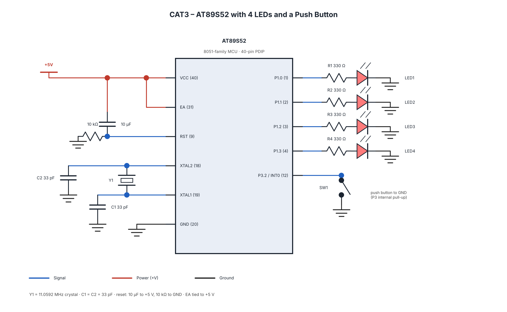

# EXPERIMENT DETAILS

**EXP:** CONTINUOUS LAB EVALUATION 3

**DATE:** 27/07/2026 (Week 2)

**NAME OF EXP:** Timer-Based LED Pattern Generator and Button Interrupt Controller

**HARDWARE SETUP / PLATFORM:** AT89S52 + 8051 Development Board + Embedded C + Keil C51

---

## TASK NO

Design and implement a four-mode LED control system using four LEDs and a push button. Each valid button press advances the operating mode, with switch debouncing to prevent repeated transitions.

**Operating Modes:**
1. Running LED – LEDs turn ON sequentially from LED1 to LED4.
2. Binary Counter – LEDs display binary values from 0000 to 1111.
3. Alternating Pattern – LEDs display 1010 and 0101 alternately.
4. All LED Flash – All four LEDs flash ON and OFF repeatedly.

**LED Pin Configuration:**
- LED1 – P1.0
- LED2 – P1.1
- LED3 – P1.2
- LED4 – P1.3
- Push Button – As configured in the source code

## CIRCUIT DIAGRAM

## CORE LOGIC / PSEUDOCODE / CODE BASE

**Core Logic:**

Configure four LED pins as outputs and the push button as input. Initialize the timer, detect valid debounced button presses, and execute the selected LED pattern. Advance through all four modes cyclically.

**Pseudocode:**
1. Initialize GPIO and timer.
2. Turn OFF all LEDs.
3. Monitor the push button.
4. Detect and debounce a valid press.
5. Advance the operating mode.
6. Execute the selected LED pattern.
7. Repeat continuously.

**Code Base:**
- `cat3_four_led_four_mode.c`
- Keil project file (`.uvproj` or `.uvprojx`)
- `STARTUP.A51`
- HEX file, if applicable.

## INFERENCE

The experiment demonstrates GPIO interfacing, timer-based LED pattern generation, push-button handling, and switch debouncing using the AT89S52 microcontroller.