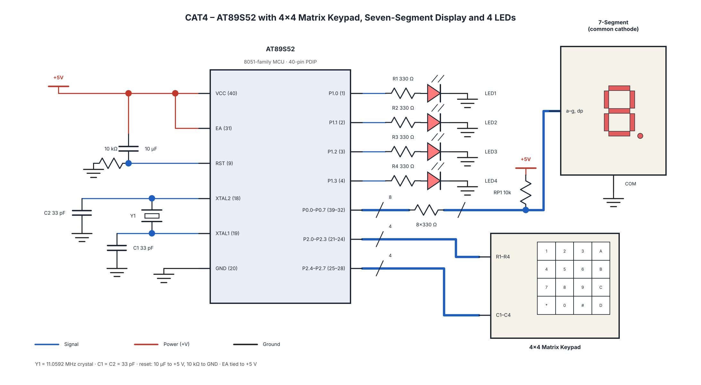

# EXPERIMENT DETAILS

**EXP:** Continuous Lab Evaluation - 4

**DATE:** 03/08/2026 (Week 3)

**NAME OF EXP:** Human-Machine Interface using Matrix Keypad, LEDs, and Seven-Segment Display

**HARDWARE SETUP / PLATFORM:** AT89S52 + 8051 Development Board + Embedded C + Keil C51 + Matrix Keypad + Seven-Segment Display + Four LEDs

---

## TASK NO

**Human-Machine Interface using Matrix Keypad, LEDs, and Seven-Segment Display**

Design an embedded user interface in which a matrix keypad acts as the input device, a seven-segment display provides visual feedback, and four LEDs indicate different operating modes.

Whenever a valid key is pressed, the corresponding key value must be displayed on the seven-segment display and the associated LED operation must be executed.

### Key Operations

| Key Pressed | Seven-Segment Display | LED Operation |
|---|---|---|
| 1 | 1 | LED1 ON |
| 2 | 2 | LED2 ON |
| 3 | 3 | LED3 ON |
| 4 | 4 | LED4 ON |
| 5 | 5 | Running LED Pattern |
| 6 | 6 | Alternate LEDs (1010 and 0101) |
| 7 | 7 | Binary Counter (0–15) |
| 8 | 8 | All LEDs Blink |
| 9 | 9 | All LEDs OFF |
| 0 | 0 | Reset System |

---

## CIRCUIT DIAGRAM

---

## CORE LOGIC / PSEUDOCODE / CODE BASE

**Core Logic:**
- Initialize the matrix keypad, LEDs and seven-segment display.
- Scan the keypad continuously.
- Detect a valid key press.
- Display the pressed key on the seven-segment display.
- Execute the corresponding LED operation.
- Repeat the process continuously.

**Required Functions:**
- `keypad_scan()` – Scans the matrix keypad and detects key presses.
- `display_digit(unsigned char value)` – Displays the pressed key.
- `led_control(unsigned char key)` – Selects the LED operation.
- `running_led()` – Produces a running LED pattern.
- `binary_counter()` – Displays a binary count from 0 to 15.
- `alternate_led()` – Produces alternating LED patterns.
- `blink_all()` – Makes all four LEDs blink.

**Pseudocode:**
1. Start.
2. Initialize keypad, LEDs and seven-segment display.
3. Scan the keypad for a valid key press.
4. Read the pressed key.
5. Display the key value.
6. Execute the corresponding LED operation.
7. Repeat continuously.

**Code Base:**
- Embedded C source file.
- Keil project file (`.uvproj` or `.uvprojx`).
- `STARTUP.A51`, if required.
- Compiled HEX file, if applicable.

## INFERENCE

The matrix keypad, LEDs and seven-segment display were interfaced with the AT89S52 microcontroller to implement a basic human-machine interface. Different LED operations were controlled based on keypad inputs, and the pressed key was displayed on the seven-segment display.