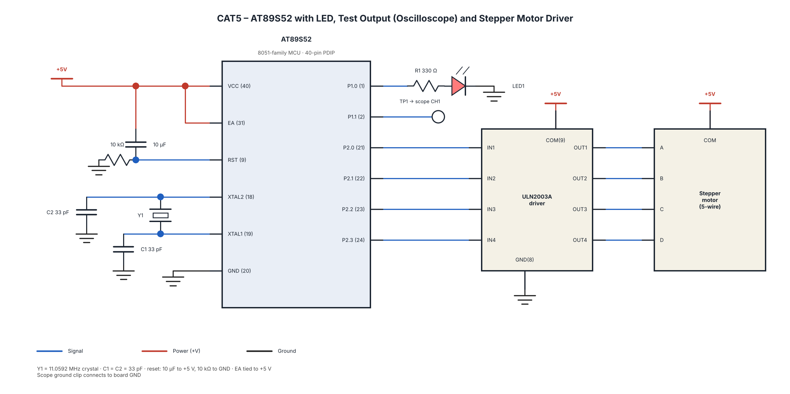

# CAT5 – Task B: LED Fading Using Timer Interrupts and Software PWM

## EXPERIMENT DETAILS
- Experiment: Continuous Lab Evaluation – 5
- Date: 10/08/2026 (Week 4)
- Microcontroller: AT89S52 (8051)
- Crystal Frequency: 11.0592 MHz
- Programming Language: Embedded C
- IDE: Keil µVision – Keil C51
- Timer: Timer 0

## OBJECTIVE
Generate software PWM using Timer 0 interrupts to vary the LED brightness gradually, demonstrating LED fading.

## CORE LOGIC
1. Configure Timer 0 to generate periodic interrupts.
2. Maintain a software counter inside the interrupt service routine.
3. Compare the counter with the selected PWM duty cycle.
4. Turn the LED ON during the active portion of the PWM period.
5. Turn the LED OFF during the remaining portion.
6. Increase the duty cycle from 0% to 100% in steps of 10%.
7. Decrease it from 100% back to 0% and repeat.

## DUTY CYCLE SEQUENCE
0%, 10%, 20%, 30%, 40%, 50%, 60%, 70%, 80%, 90%, 100%, then back down to 0%.

## PWM OPERATION
- Suggested PWM frequency: 500 Hz–1 kHz
- Lower duty cycle: lower LED brightness
- Higher duty cycle: higher LED brightness
- 0% duty cycle: LED remains OFF
- 100% duty cycle: LED remains ON

## CODE BASE
- cat5_task2_led_fading.c

## CIRCUIT DIAGRAM

## INFERENCE
Software PWM generated using timer interrupts provides brightness control without dedicated PWM hardware. Varying the duty cycle produces the gradual LED fading effect.
