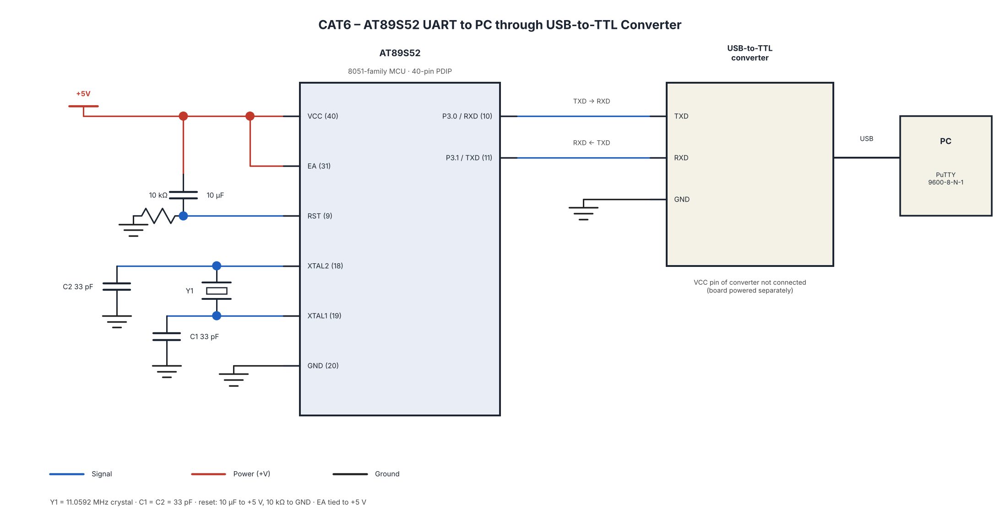

# CAT6 – Task A: UART Initialization and Character Transmission

## EXPERIMENT DETAILS
- Experiment: Continuous Lab Evaluation – 6
- Date: 17/08/2026 (Week 5)
- Microcontroller: AT89S52 (8051)
- Crystal Frequency: 11.0592 MHz
- Programming Language: Embedded C
- IDE: Keil µVision – Keil C51
- Serial Terminal: PuTTY
- Baud Rate: 9600
- UART Format: 9600-8-N-1

## OBJECTIVE
Initialize the 8051 UART in Mode 1 and continuously transmit the message "Hello from 8051" to a PC using a USB-to-TTL serial converter.

## UART CONFIGURATION
- UART Mode: Mode 1 (8-bit UART, variable baud rate)
- Timer: Timer 1, Mode 2 (8-bit auto-reload)
- TH1 = 0xFD for 9600 baud
- SCON configured for UART Mode 1 with reception enabled
- TR1 = 1 to start Timer 1

## CORE LOGIC
1. Configure Timer 1 in Mode 2.
2. Load TH1 with 0xFD.
3. Configure the UART using SCON.
4. Start Timer 1.
5. Load each character into SBUF.
6. Wait until TI is set.
7. Clear TI and transmit the next character.
8. Repeat the message continuously.

## SERIAL CONNECTIONS
- AT89S52 TXD (P3.1) → USB-to-TTL RXD
- AT89S52 RXD (P3.0) → USB-to-TTL TXD
- AT89S52 GND → USB-to-TTL GND

## PUTTY SETTINGS
- Connection type: Serial
- Baud rate: 9600
- Data bits: 8
- Parity: None
- Stop bits: 1
- Flow control: None

## CODE BASE
- cat6_taskA_uart_transmit.c

## CIRCUIT DIAGRAM

## INFERENCE
The UART peripheral successfully transmits serial characters using Timer 1 as the baud-rate generator. The transmitted message can be monitored using PuTTY.
