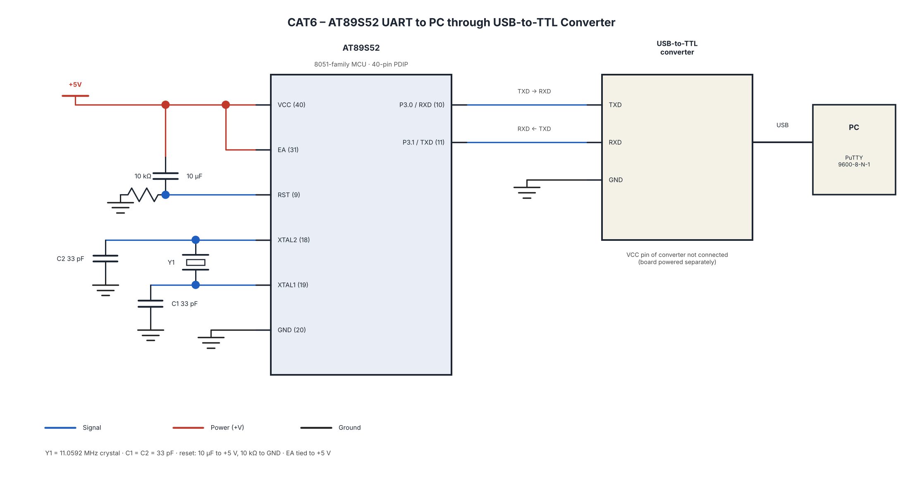

# CAT6 – Task B: UART Character Reception and Echo

## EXPERIMENT DETAILS
- Experiment: Continuous Lab Evaluation – 6
- Date: 17/08/2026 (Week 5)
- Microcontroller: AT89S52 (8051)
- Crystal Frequency: 11.0592 MHz
- Programming Language: Embedded C
- IDE: Keil µVision – Keil C51
- Serial Terminal: PuTTY
- Baud Rate: 9600
- UART Format: 9600-8-N-1

## OBJECTIVE
Receive characters sent from a PC through UART and transmit the same characters back to the PC, demonstrating serial communication and echo functionality.

## UART CONFIGURATION
- UART Mode: Mode 1 (8-bit UART, variable baud rate)
- Timer: Timer 1, Mode 2 (8-bit auto-reload)
- TH1 = 0xFD for 9600 baud
- TXD: P3.1
- RXD: P3.0

## CORE LOGIC
1. Configure Timer 1 in Mode 2 and load TH1 with 0xFD.
2. Configure the UART in Mode 1 using SCON.
3. Start Timer 1.
4. Wait until the RI flag indicates that a character has been received.
5. Read the received character from SBUF.
6. Clear RI.
7. Load the received character into SBUF for transmission.
8. Wait until TI is set, then clear TI.
9. Repeat to echo incoming characters.

## SERIAL CONNECTIONS
- AT89S52 TXD (P3.1) → USB-to-TTL RXD
- AT89S52 RXD (P3.0) → USB-to-TTL TXD
- AT89S52 GND → USB-to-TTL GND

## PUTTY SETTINGS
- Connection type: Serial
- Baud rate: 9600
- Data bits: 8
- Parity: None
- Stop bits: 1
- Flow control: None

## EXPECTED OBSERVATION
When `ABC123` is typed in PuTTY, the same characters are transmitted back and displayed.

## CODE BASE
- cat6_taskB_uart_echo.c

## CIRCUIT DIAGRAM

## INFERENCE
UART reception and transmission enable two-way serial communication. By reading each received character and transmitting it back, the 8051 performs a character echo operation.
