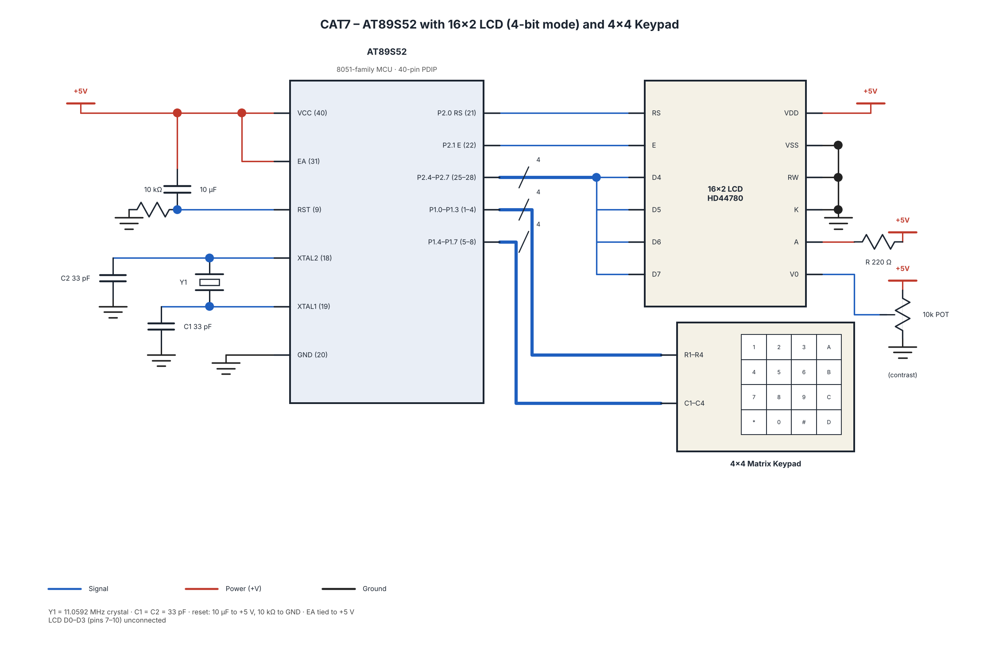

# CAT7 – Task A: 16x2 LCD Driver Using 4-Bit GPIO Mode

## EXPERIMENT DETAILS
- Experiment: Continuous Lab Evaluation – 7
- Date: 24/08/2026 (Week 6)
- Microcontroller: AT89S52 (8051)
- Crystal Frequency: 11.0592 MHz
- Programming Language: Embedded C
- IDE: Keil µVision – Keil C51
- Display: HD44780-Compatible 16x2 Character LCD
- LCD Interface: 4-Bit GPIO Mode

## OBJECTIVE
Develop a basic 16x2 LCD driver using 4-bit GPIO mode and display individual characters and strings on both LCD rows.

## LCD CONFIGURATION
- Data interface: 4-bit mode
- Display lines: 2
- Character font: 5x8 dots
- Controller: HD44780-compatible

## CORE LOGIC
1. Configure the LCD control and data pins as GPIO.
2. Initialize the LCD in 4-bit mode.
3. Configure the display for 2 lines and a 5x8 character font.
4. Implement functions to send commands and character data.
5. Implement string display functionality.
6. Display characters and strings on both rows.

## REQUIRED DRIVER FUNCTIONS
- `lcd_cmd()`: Sends a command to the LCD.
- `lcd_data()`: Sends character data to the LCD.
- `lcd_init()`: Initializes the LCD in 4-bit, 2-line mode.
- String display logic: Sends a sequence of characters to the LCD.

## CODE BASE
- cat7_task7A_lcd.c

## CIRCUIT DIAGRAM

## INFERENCE
The 4-bit GPIO LCD driver successfully demonstrates LCD initialization, command transmission, and character display using the 8051 microcontroller.
