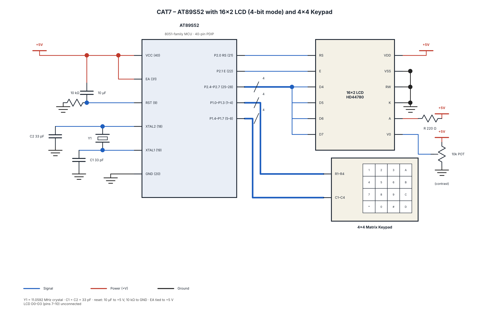

# CAT7 – Task B: LCD Cursor Positioning and Dynamic Value Display

## EXPERIMENT DETAILS
- Experiment: Continuous Lab Evaluation – 7
- Date: 24/08/2026 (Week 6)
- Microcontroller: AT89S52 (8051)
- Crystal Frequency: 11.0592 MHz
- Programming Language: Embedded C
- IDE: Keil µVision – Keil C51
- Display: HD44780-Compatible 16x2 Character LCD
- LCD Interface: 4-Bit GPIO Mode

## OBJECTIVE
Extend the basic LCD driver to position the cursor at selected rows and columns and display or update strings and numerical values dynamically.

## CORE LOGIC
1. Initialize the LCD using the 4-bit GPIO driver.
2. Select the required LCD row and column.
3. Convert the row and column into the corresponding DDRAM address.
4. Position the cursor using an LCD command.
5. Display strings at the selected location.
6. Convert numerical values into displayable characters.
7. Update the displayed values dynamically.

## REQUIRED FUNCTIONS
- `lcd_goto(row, column)`: Positions the cursor at the specified row and column.
- `lcd_puts(string)`: Displays a string on the LCD.
- `lcd_print_number(value)`: Converts and displays a numerical value.

## LCD DISPLAY
- Display size: 16 columns × 2 rows
- Row 1: Columns 1–16
- Row 2: Columns 1–16
- Cursor positioning uses the LCD DDRAM address.

## CODE BASE
- cat7_task7B_lcd_cursor.c

## CIRCUIT DIAGRAM

## INFERENCE
Cursor positioning and dynamic display functions allow information to be updated at specific LCD locations without rewriting the entire display.
