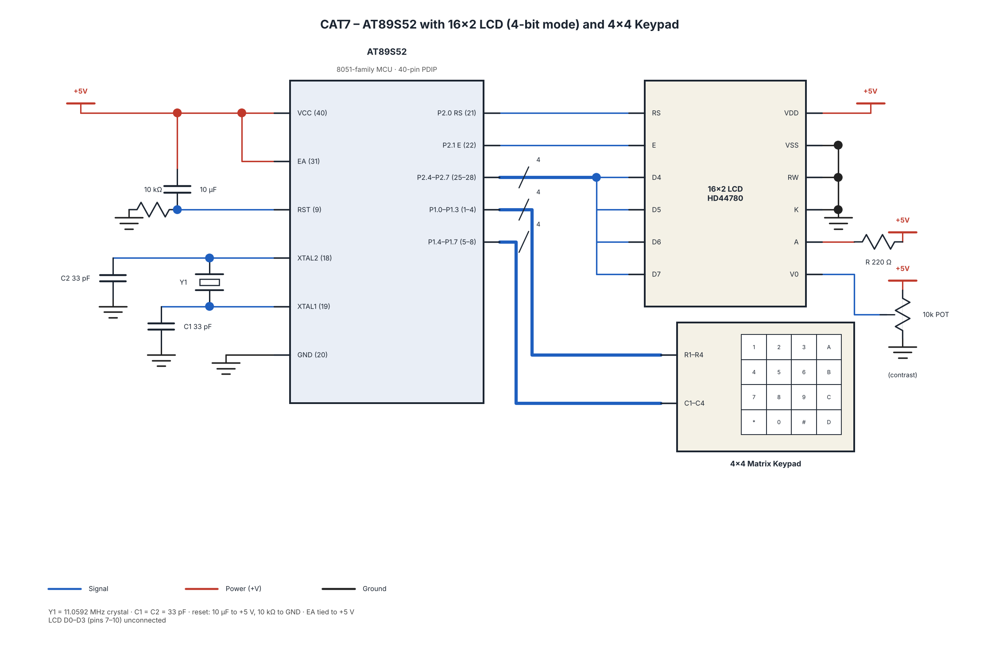

# CAT7 – Task C: Character Movement on LCD Using a 4x4 Keypad

## EXPERIMENT DETAILS
- Experiment: Continuous Lab Evaluation – 7
- Date: 24/08/2026 (Week 6)
- Microcontroller: AT89S52 (8051)
- Crystal Frequency: 11.0592 MHz
- Programming Language: Embedded C
- IDE: Keil µVision – Keil C51
- Display: HD44780-Compatible 16x2 Character LCD
- Input: 4x4 Matrix Keypad
- LCD Interface: 4-Bit GPIO Mode

## OBJECTIVE
Move a character across a 16x2 LCD using directional keys from a 4x4 matrix keypad.

## CORE LOGIC
1. Initialize the LCD and keypad GPIO pins.
2. Display a character at the initial LCD position.
3. Continuously scan the keypad for key presses.
4. Identify the pressed key and determine the movement direction.
5. Calculate the new row and column position.
6. Clear the previous character position.
7. Display the character at the updated position.
8. Repeat the process to allow continuous movement.

## KEYPAD CONTROLS

| Key | Function |
|---|---|
| 1 | Up |
| 2 | Down |
| + | Left |
| - | Right |
| Q | Search |
| H | Hints |

## LCD DISPLAY
- Display size: 16 columns × 2 rows
- Character position is updated according to the directional key pressed.
- Movement is restricted to valid LCD row and column positions.

## CODE BASE
- cat7_task7C_keypad_lcd.c

## CIRCUIT DIAGRAM

## INFERENCE
The experiment demonstrates GPIO-based keypad scanning and LCD control. Directional key presses update the character position on the 16x2 display.
