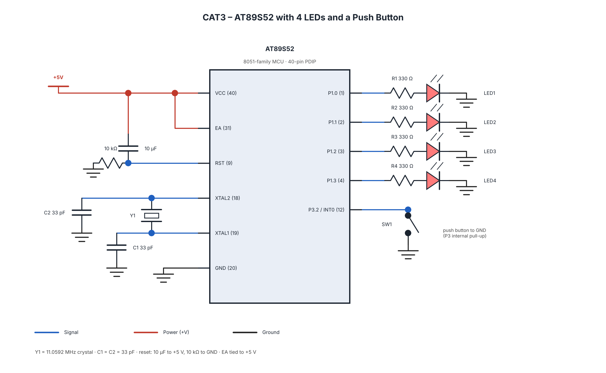

# CAT3

## EXP
CAT3 – Continuous Lab Evaluation 3

## DATE
27/07/2026 (Week 2)

## NAME OF EXP
Timer-Based LED Pattern Generator and Button Interrupt Controller

## HARDWARE SETUP / PLATFORM
- Microcontroller: AT89S52
- Development Board: 8051 Development Board
- Programming Language: Embedded C
- Compiler: Keil C51
- Peripherals:
  - Four LEDs
  - One Push Button
  - Crystal Oscillator
- GPIO Configuration:
  - LED1 – P1.0
  - LED2 – P1.1
  - LED3 – P1.2
  - LED4 – P1.3
  - Push Button – [Enter the actual pin used in the source code]

## TASK NO
**Timer-Based LED Pattern Generator and Button Interrupt Controller**

Design and implement a four-state LED control system using four LEDs and one push button. Each valid button press advances the system to the next operating mode. Implement switch debouncing to ensure that one physical button press produces exactly one state transition.

### Required Operating Modes

1. **Mode 1 – Running LED:** LEDs turn ON sequentially from LED1 to LED4.
2. **Mode 2 – Binary Counter:** Four LEDs display a binary count from 0000 to 1111 and repeat.
3. **Mode 3 – Alternating Pattern:** LEDs display 1010 and 0101 alternately.
4. **Mode 4 – All LED Flash:** All four LEDs flash ON and OFF repeatedly.

## Circuit Diagram

## Core Logic / Pseudocode / Code Base

### Core Logic
- Configure four LED pins as digital outputs.
- Configure the push button as a digital input.
- Initialize the required timer configuration.
- Continuously monitor the push-button input.
- Apply switch debouncing to detect valid button presses.
- Advance the operating mode after each valid press.
- Execute the LED pattern corresponding to the selected mode.
- Repeat the process continuously.

### Pseudocode

1. Start.
2. Initialize GPIO pins and timer.
3. Set all LEDs to OFF.
4. Monitor the push button.
5. Detect and debounce a valid button press.
6. Increment the operating mode.
7. Execute the selected LED pattern.
8. Repeat continuously.

### Code Base
- `cat3_four_led_four_mode.c`
- Keil project file (`.uvproj` or `.uvprojx`)
- `STARTUP.A51`
- Compiled HEX file (`.hex`), if applicable.

## INFERENCE

The four-state LED control system demonstrates GPIO interfacing, timer-based LED pattern generation, push-button input handling and switch debouncing using the AT89S52 microcontroller.