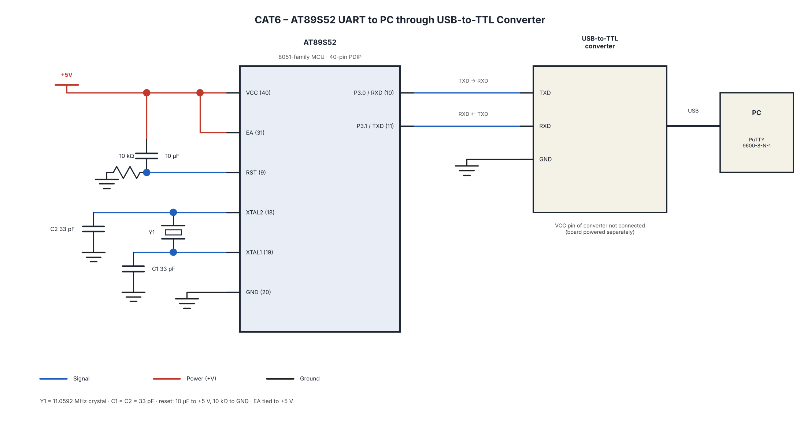

# CAT6 – UART Driver and Serial Debugging

## EXP
Continuous Lab Evaluation – 6

## DATE
17/08/2026 (Week 5)

## NAME OF EXP
UART Driver and Serial Debugging

## HARDWARE SETUP / PLATFORM
- **Microcontroller:** AT89S52 (8051)
- **Crystal Frequency:** 11.0592 MHz
- **Programming Language:** Embedded C
- **IDE / Compiler:** Keil µVision – Keil C51
- **Hardware:** AT89S52 Development Board, USB-to-TTL Serial Converter, PC
- **Serial Terminal:** PuTTY
- **UART Communication:** 9600 Baud, 8 Data Bits, No Parity, 1 Stop Bit (9600-8-N-1)
- **UART Pins:**
  - TXD – P3.1
  - RXD – P3.0
- **Baud Rate Generation:** Timer 1, Mode 2 (8-bit auto-reload)
- **Restrictions:** No Arduino APIs, HAL libraries, or RTOS services.

## TASK NO

### Task A – UART Initialization and Character Transmission

**Problem Statement:**

Configure the AT89S52 UART for 8-bit asynchronous serial communication at 9600 baud, with 1 stop bit and no parity. Continuously transmit the message "Hello from 8051" to a PC terminal using PuTTY through a USB-to-TTL serial converter.

**Core Logic:**
1. Configure Timer 1 in Mode 2 for baud-rate generation.
2. Load TH1 with the required reload value.
3. Configure SCON for UART Mode 1 and enable reception.
4. Start Timer 1.
5. Transmit characters through the SBUF register.
6. Monitor the TI flag to identify transmission completion.
7. Continuously transmit the message to PuTTY.

**UART Configuration:**

| Parameter | Configuration |
|---|---|
| UART Mode | Mode 1 |
| Baud Rate | 9600 |
| Data Bits | 8 |
| Stop Bits | 1 |
| Parity | None |
| Timer | Timer 1, Mode 2 |
| TH1 | 0xFD |

### Task B – UART Echo Using Character Reception

**Problem Statement:**

Develop an interactive UART application in which every character received from PuTTY is immediately transmitted back to the PC terminal.

**Expected Output:**

If the user types:

`ABC123`

The terminal should display:

`ABC123`

**Core Logic:**
1. Initialize UART communication at 9600 baud.
2. Enable UART reception.
3. Wait for a character to arrive from PuTTY.
4. Check the RI flag to identify reception completion.
5. Read the received character from the SBUF register.
6. Clear the RI flag.
7. Transmit the same character back to PuTTY.
8. Repeat continuously.

**UART Registers and Flags:**

| Register / Flag | Purpose |
|---|---|
| SCON | Selects UART operating mode |
| SBUF | Transmits and receives serial data |
| TI | Indicates transmission completion |
| RI | Indicates reception completion |
| TMOD | Configures Timer 1 mode |
| TH1 | Stores Timer 1 reload value |
| TR1 | Starts Timer 1 |

**Baud Rate Calculation:**

For an AT89S52 with an 11.0592 MHz crystal, using Timer 1 Mode 2 and UART Mode 1 with SMOD = 0:

- Crystal frequency = 11.0592 MHz
- Required baud rate = 9600
- Timer 1 reload value = 0xFD

## CIRCUIT DIAGRAM

**UART Connections:**

| AT89S52 | USB-to-TTL Converter |
|---|---|
| TXD (P3.1) | RXD |
| RXD (P3.0) | TXD |
| GND | GND |

*Note: Use the actual board schematic and USB-to-TTL converter voltage requirements when preparing the circuit diagram.*

## CORE LOGIC / PSEUDOCODE / CODE BASE

**General Pseudocode:**

1. Initialize UART.
2. Configure Timer 1 for baud-rate generation.
3. Start Timer 1.
4. For Task A:
   - Transmit the message through SBUF.
   - Wait for TI to become 1.
   - Clear TI.
   - Repeat transmission.
5. For Task B:
   - Check RI for received data.
   - Read the received character from SBUF.
   - Clear RI.
   - Transmit the received character back.
   - Repeat continuously.

**Code Base:**

- `cat6_taskA_uart_transmit.c`
- `cat6_taskB_uart_echo.c` (if implemented)

## INFERENCE

The experiment demonstrates UART-based serial communication using the AT89S52 microcontroller. Timer 1 is used for baud-rate generation, while the UART transmits and receives data through the TXD and RXD pins. PuTTY is used to verify continuous message transmission and character echo communication through a USB-to-TTL serial interface.