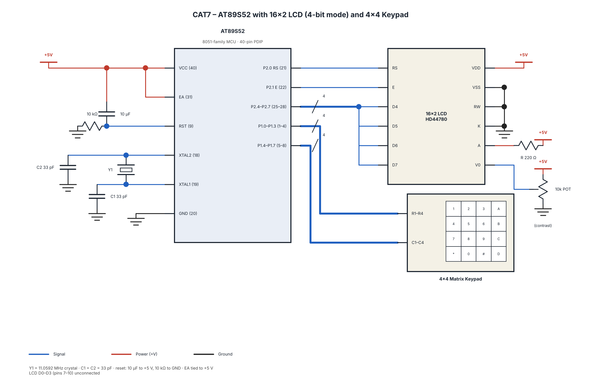

# CAT7 – 16x2 LCD Driver Development and Dynamic Display Control

## EXP
Continuous Lab Evaluation – 7

## DATE
24/08/2026 (Week 6)

## NAME OF EXP
16x2 LCD Driver Development and Dynamic Display Control

## HARDWARE SETUP / PLATFORM
- **Microcontroller:** AT89S52 (8051)
- **LCD:** HD44780-compatible 16x2 Character LCD
- **Keypad:** 4x4 Matrix Keypad
- **Programming Language:** Embedded C
- **IDE / Compiler:** Keil µVision – Keil C51
- **Crystal Frequency:** 11.0592 MHz
- **Hardware:** AT89S52 Development Board, 16x2 LCD, 4x4 Keypad
- **Debugging Tools:** Multimeter and Digital Storage Oscilloscope (DSO)
- **LCD Interface:** 4-bit GPIO mode
- **Restrictions:** No Arduino APIs, HAL libraries, or RTOS services.

## TASK NO

### Task 7A – LCD Initialization and Character/String Display

**Problem Statement:**

Develop a 4-bit GPIO-based LCD driver for the AT89S52 using the HD44780-compatible LCD datasheet. Initialize the 16x2 LCD in 4-bit, 2-line mode and display individual characters and strings on both rows.

**Core Logic:**
1. Configure the LCD control and data pins.
2. Initialize the LCD in 4-bit mode.
3. Configure the LCD for 2-line display and 5x8 character font.
4. Implement `lcd_cmd()` to send commands.
5. Implement `lcd_data()` to send character data.
6. Implement `lcd_init()` to initialize the LCD.
7. Display individual characters and strings on both rows.

**Required Functions:**
- `lcd_init()`
- `lcd_cmd()`
- `lcd_data()`

### Task 7B – Cursor Positioning and Dynamic Value Update

**Problem Statement:**

Develop LCD cursor-positioning and data-update functions to display strings and numerical values at specified positions on the 16x2 LCD.

**Core Logic:**
1. Select the required LCD row and column.
2. Set the cursor position using the corresponding DDRAM address.
3. Display strings using the LCD string function.
4. Convert numerical values into displayable characters.
5. Update the displayed values dynamically.

**Required Functions:**
- `lcd_goto(row, column)`
- `lcd_puts(string)`
- `lcd_print_number(value)`

### Task 7C – 4x4 Keypad-Based Character Movement

**Problem Statement:**

Develop an interactive LCD application in which a character moves across the 16x2 LCD based on directional keys pressed on a 4x4 matrix keypad.

**Key Operations:**

| Key | Action |
|---|---|
| 1 | Move Up |
| 2 | Move Down |
| + | Move Left |
| - | Move Right |
| Q | Search |
| H | Hints |

**Core Logic:**
1. Initialize the LCD and keypad.
2. Display a character at the initial LCD position.
3. Scan the keypad to detect a key press.
4. Identify the pressed key.
5. Update the character position according to the assigned key.
6. Clear the previous character position.
7. Display the character at the new position.
8. Repeat the process to allow continuous interaction.

## CIRCUIT DIAGRAM

**LCD Interface:**
- RS – Register Select
- RW – Read/Write
- E – Enable
- D4–D7 – 4-bit data lines
- VCC and GND – Power supply
- V0 – Contrast adjustment

*Note: Add the actual LCD and keypad circuit diagram as `circuit.png`. The pin connections must match the source code and board schematic.*

## CORE LOGIC / PSEUDOCODE / CODE BASE

**General Pseudocode:**

1. Initialize the required GPIO pins.
2. Initialize the LCD using the HD44780 command sequence.
3. Configure the LCD for 4-bit, 2-line operation.
4. Display the required characters and strings.
5. Position the cursor using the DDRAM address.
6. Read numerical values and update the display.
7. For keypad control:
   - Scan the keypad.
   - Identify the pressed key.
   - Update the character position.
   - Display the character at the new position.
8. Repeat the required display operations.

**Code Base:**

- `cat7_task7A_lcd.c`
- `cat7_task7B_lcd_cursor.c`
- `cat7_task7C_keypad_lcd.c`

## INFERENCE

The experiment demonstrates the development of a low-level 4-bit LCD driver using the AT89S52 microcontroller. The HD44780-compatible LCD is initialized using the required command sequence to display characters and strings. Cursor positioning and dynamic numerical updates are implemented using LCD functions. The 4x4 keypad is used to control character movement on the LCD. This experiment provides practical understanding of peripheral datasheets, GPIO interfacing, LCD commands, and embedded C programming.