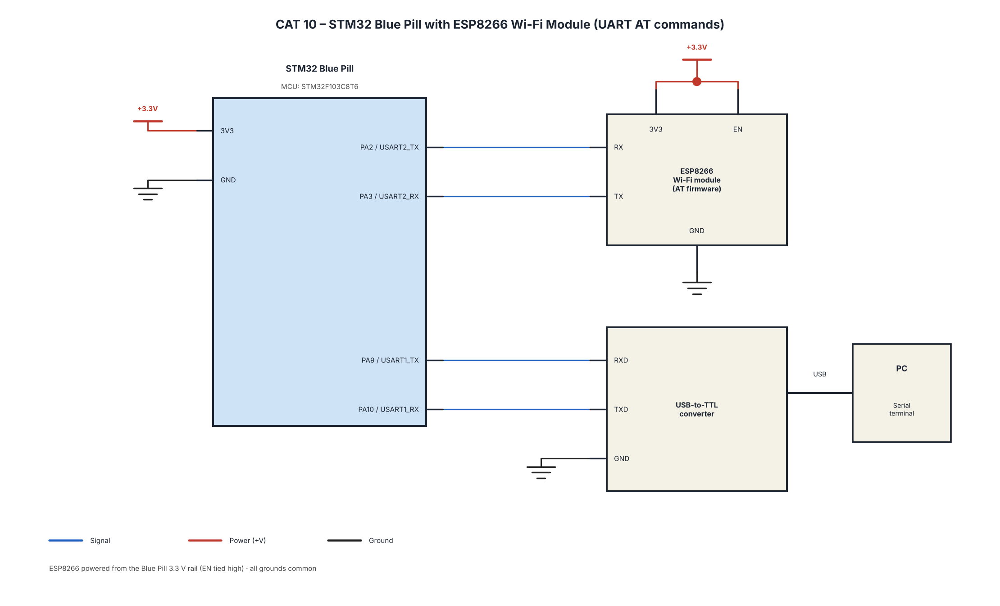

# EXPERIMENT DETAILS

**EXP:** Continuous Lab Evaluation – 10

**NAME OF EXP:** STM32 and ESP8266 Wi-Fi Communication

**HARDWARE SETUP / PLATFORM:** STM32 Blue Pill (STM32F103C8T6) + ESP8266 / Wemos Wi-Fi Module + USB-to-TTL Converter + STM32CubeMX + Keil MDK-ARM + Arduino IDE (for module testing) + STM32 HAL Library

---

## TASK NO

### Task A – UART Communication with ESP8266

**Objective:**

Establish UART communication between STM32 and ESP8266.

**Implementation:**

1. Configure UART communication using STM32CubeMX.
2. Initialize UART using STM32 HAL functions.
3. Send AT commands from STM32 to ESP8266.
4. Receive and examine responses from the ESP8266 module.

### Task B – ESP8266 AT Commands

**Objective:**

Explore and test the AT command interface of ESP8266.

**Implementation:**

1. Test basic AT commands.
2. Check module firmware information.
3. Explore Wi-Fi configuration commands.
4. Test network-related commands and examine module responses.

### Task C – Wi-Fi Connection

**Objective:**

Connect the ESP8266 module to a Wi-Fi network using AT commands.

**Implementation:**

1. Configure the ESP8266 Wi-Fi mode.
2. Send AT commands to connect to a Wi-Fi network.
3. Receive and check the connection response.
4. Verify successful network connectivity.

---

## CIRCUIT DIAGRAM

The same STM32–ESP8266 UART communication setup is used for Tasks A, B and C.

---

## CORE LOGIC / PSEUDOCODE / CODE BASE

**Core Logic:**

- Initialize UART communication between STM32 and ESP8266.
- Send AT commands through the UART interface.
- Receive and process responses from the ESP8266.
- Test basic AT commands and firmware information.
- Configure the Wi-Fi operating mode.
- Connect the ESP8266 to the required Wi-Fi network.
- Verify the connection response.

**General Pseudocode:**

1. Initialize GPIO and UART peripherals.
2. Establish UART communication with ESP8266.
3. Send the `AT` command.
4. Receive and verify the response.
5. Send the required AT commands.
6. Check firmware information and Wi-Fi configuration.
7. Set the required Wi-Fi mode.
8. Connect to the Wi-Fi network.
9. Receive and verify the