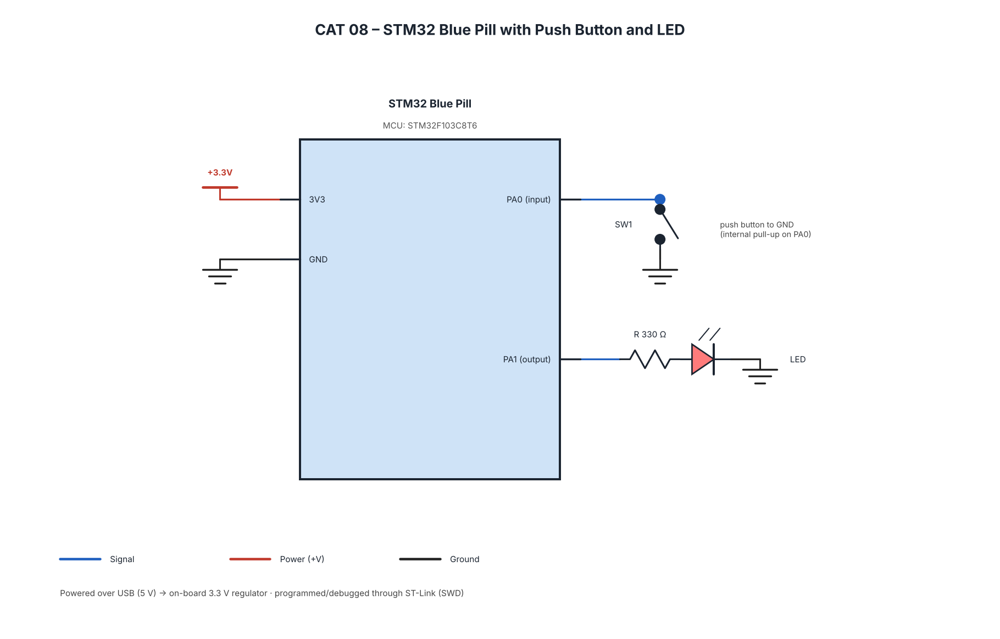

# EXPERIMENT DETAILS

**EXP:** Continuous Lab Evaluation – 8

**DATE:** 18/09/2026 (Week 8)

**NAME OF EXP:** STM32 GPIO Bring-Up and Switch-Controlled LED

**HARDWARE SETUP / PLATFORM:** STM32 Blue Pill + STM32CubeMX + Keil MDK + STM32 HAL Libraries + Push-Button + LED

---

## TASK NO

### Task 8A – GPIO Input/Output

**Problem Statement:**

Interface a push-button and LED with the STM32. Configure GPIO pins for input and output. Turn the LED ON when the switch is pressed and turn it OFF when the switch is released.

**Core Logic:**

1. Configure the required GPIO pins for input and output.
2. Read the push-button state using `HAL_GPIO_ReadPin()`.
3. Turn the LED ON when the switch is pressed.
4. Turn the LED OFF when the switch is released.
5. Repeat continuously.

### Task 8B – Event-Based Control

**Problem Statement:**

Modify the firmware so each valid switch press toggles the LED state. Investigate switch bounce and implement software debouncing so one press produces one toggle.

**Core Logic:**

1. Read the push-button state.
2. Detect a valid button press.
3. Apply software debouncing.
4. Toggle the LED only once for each valid press.
5. Wait for the button release before detecting the next press.

### Task 8C – Short Press vs Long Press

**Problem Statement:**

Classify button presses based on duration and perform different LED operations.

**Press Duration:**

- **Short press:** Less than 1 second.
- **Long press:** 1 second or more.

**Expected Behaviour:**

| User Action | System Response |
|---|---|
| Short press | Toggle LED |
| Long press | LED enters continuous blinking mode |
| Next short press | Stop blinking |
| Long press again | Return to blinking mode |

**Important Constraint:** Do not use a blocking delay to determine whether a button is held for a long press. Use a non-blocking time measurement approach.

**Core Logic:**

1. Detect the button press and record the start time using `HAL_GetTick()`.
2. Continuously monitor the button state.
3. Calculate the press duration without blocking the program.
4. If the duration is less than 1 second, toggle the LED.
5. If the duration is 1 second or more, activate or deactivate blinking mode.
6. Continue monitoring button events.

---

## CIRCUIT DIAGRAM

The same push-button and LED circuit is used for Tasks 8A, 8B and 8C.

**Hardware Components:**

- STM32 Blue Pill development board
- Push-button
- LED
- Current-limiting resistor
- Breadboard and jumper wires

---

## CORE LOGIC / PSEUDOCODE / CODE BASE

**Core HAL Functions:**

- `HAL_GPIO_ReadPin()` – Read switch state.
- `HAL_GPIO_WritePin()` – Control LED.
- `HAL_GPIO_TogglePin()` – Toggle LED.
- `HAL_GetTick()` – Measure button press duration.
- `HAL_Delay()` – Optional