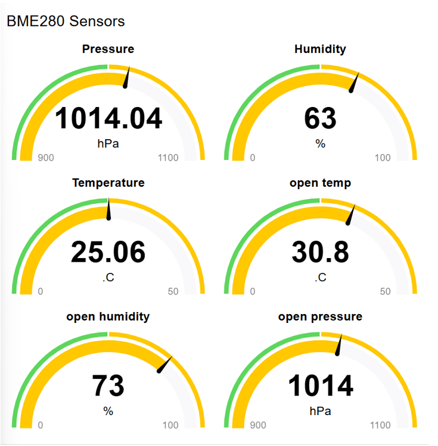
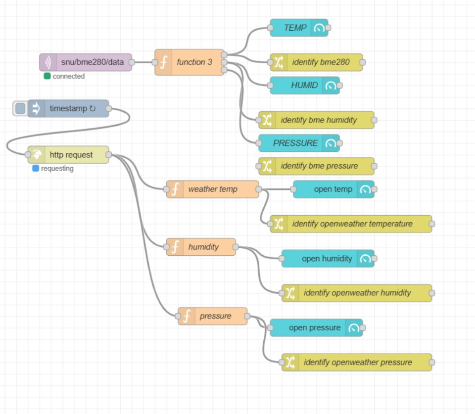
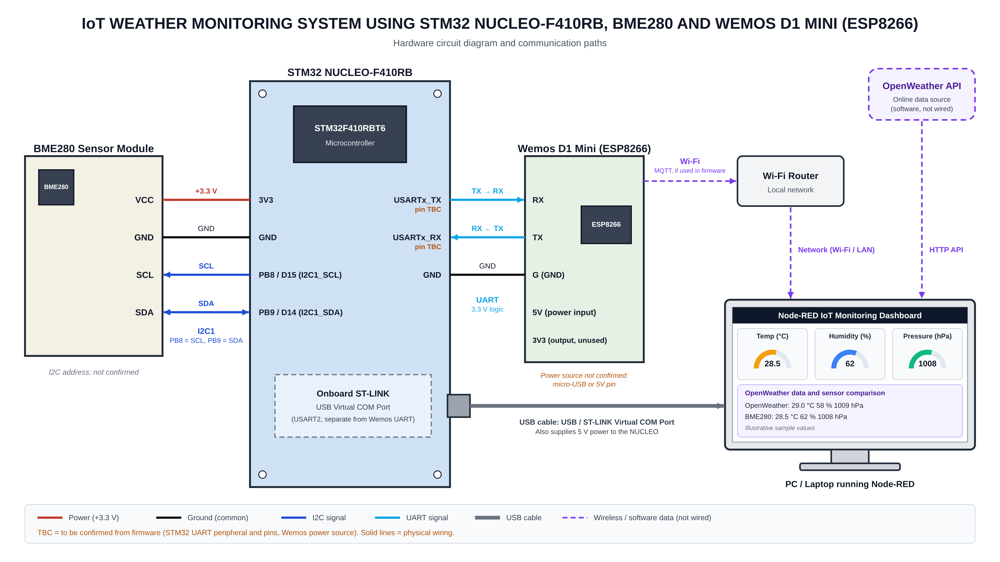

# CAT 15 – STM32-Based IoT Weather Monitoring System Using BME280 and Wemos ESP8266

## Overview

This project implements an IoT-based weather monitoring system using the **STM32 NUCLEO-F410RB development board**, **BME280 environmental sensor**, and **Wemos ESP8266 Wi-Fi module**.

The BME280 sensor measures temperature, humidity, and atmospheric pressure. The STM32 microcontroller reads the sensor data and communicates with the Wemos ESP8266 module.

The Wemos ESP8266 provides Wi-Fi connectivity for transferring environmental data to the monitoring system. Node-RED is used for data processing and dashboard visualization.

The project also incorporates the OpenWeather API to obtain external weather information for comparison with locally measured environmental parameters.

## Hardware Requirements

- STM32 NUCLEO-F410RB Development Board
- BME280 Environmental Sensor
- Wemos D1 Mini (ESP8266 Wi-Fi Module)
- USB Cable (ST-LINK Virtual COM Port)
- Jumper Wires

## Software and Tools

- STM32CubeMX
- Keil MDK-ARM
- STM32 HAL Library
- Embedded C
- Arduino IDE (where used for Wemos programming)
- Node-RED
- Node-RED Dashboard
- OpenWeather API
- MQTT / ESP8266 communication components (where configured)

## Project Objective

To develop an IoT-based environmental monitoring system that measures real-time temperature, humidity, and atmospheric pressure using the BME280 sensor interfaced with an STM32 microcontroller.

The collected sensor data is communicated through the Wemos ESP8266 Wi-Fi module and processed using Node-RED for real-time monitoring and visualization.

The project also explores the integration of external weather information using the OpenWeather API.

## System Architecture

1. **BME280 Sensor:** Measures temperature, humidity, and atmospheric pressure.
2. **STM32 NUCLEO-F410RB:** Reads and processes environmental sensor measurements.
3. **Wemos ESP8266:** Provides Wi-Fi connectivity for data communication.
4. **Node-RED:** Receives and processes environmental data.
5. **Node-RED Dashboard:** Displays sensor readings graphically.
6. **OpenWeather API:** Provides external weather information for comparison.

## Implementation

### TASK 15A – BME280 Sensor Interfacing with STM32

**Objective:** Interface the BME280 environmental sensor with the STM32 NUCLEO-F410RB board.

**Implementation:**

- Interfaced the BME280 sensor with the STM32 board.
- Integrated the BME280 driver files (`bme280.c`, `bme280.h`, and `bme280_defs.h`).
- Configured the required peripherals using STM32CubeMX.
- Developed Embedded C code using the STM32 HAL Library.
- Acquired temperature, humidity, and pressure readings.

**Observation:** The STM32 successfully acquired environmental measurements from the BME280 sensor.

### TASK 15B – Wemos ESP8266 Communication

**Objective:** Establish communication between the STM32 board and Wemos ESP8266 for IoT data transmission.

**Implementation:**

- Used the STM32 serial communication interface.
- Connected the Wemos ESP8266 module for Wi-Fi communication.
- Prepared environmental sensor readings for transmission.
- Used the ESP8266 communication interface to transfer data towards the monitoring workflow.

**Observation:** The STM32 and Wemos communication was used as part of the IoT monitoring workflow.

### TASK 15C – Node-RED Dashboard Development

**Objective:** Display real-time environmental measurements using a graphical dashboard.

**Implementation:**

- Used Node-RED for data processing and visualization.
- Configured the data flow using Function and Change nodes.
- Created dashboard gauges for temperature, humidity, and atmospheric pressure.
- Connected the sensor data processing flow to dashboard components.
- Displayed the environmental readings through the Node-RED dashboard.

**Observation:** The dashboard displayed the BME280 sensor readings for environmental monitoring.

### TASK 15D – OpenWeather API Integration

**Objective:** Obtain external weather information for comparison with locally measured sensor values.

**Implementation:**

- Integrated the OpenWeather API into the Node-RED flow.
- Configured an HTTP request to retrieve weather information.
- Processed the API response using Function nodes.
- Extracted temperature, humidity, and pressure parameters.
- Prepared Change nodes and a comparison Function to process the six environmental values.

**Observation:** The OpenWeather API response was successfully retrieved and processed. Automated comparison of local sensor readings and external weather parameters is ongoing.

## Node-RED Dashboard Output

The Node-RED dashboard provides graphical representations of the environmental parameters measured by the BME280 sensor.

- Temperature (°C)
- Relative Humidity (%)
- Atmospheric Pressure (hPa)

### Dashboard Screenshot

*Figure 1: Node-RED dashboard displaying environmental sensor readings.*

### Node-RED Flow

*Figure 2: Node-RED flow showing sensor data processing, OpenWeather API integration, and dashboard connections.*

## Hardware Setup

The BME280 environmental sensor is interfaced with the STM32 NUCLEO-F410RB development board. The Wemos ESP8266 module is used for Wi-Fi communication.

### Hardware Components

- STM32 NUCLEO-F410RB
- BME280 Environmental Sensor
- Wemos D1 Mini (ESP8266)
- USB connection for programming and serial communication
- Jumper wires

*Figure 3: Hardware interfacing of STM32, BME280, and Wemos ESP8266.*

## Key Concepts Demonstrated

- STM32 Microcontroller Programming
- BME280 Sensor Interfacing
- Temperature Measurement
- Humidity Measurement
- Atmospheric Pressure Measurement
- STM32 HAL Library
- UART Serial Communication
- ESP8266 Wi-Fi Communication
- Wemos D1 Mini Integration
- Node-RED Flow Development
- IoT Data Visualization
- HTTP Request and API Integration
- OpenWeather API
- Environmental Data Monitoring

## Conclusion

The project demonstrates the development of an IoT-based weather monitoring system using the STM32 NUCLEO-F410RB development board, BME280 environmental sensor, and Wemos ESP8266 Wi-Fi module.

The system acquires temperature, humidity, and atmospheric pressure readings from the BME280 sensor. The STM32 processes the measurements, while the Wemos ESP8266 provides Wi-Fi communication for the IoT monitoring workflow.

Node-RED is used to process and visualize the environmental measurements through a dashboard. OpenWeather API integration provides external weather information and introduces the possibility of comparing locally measured parameters with online weather data.

This project provides practical experience in embedded systems programming, sensor interfacing, UART communication, Wi-Fi connectivity, IoT data visualization, and API integration.

## Project Information

- **Platform:** STM32 NUCLEO-F410RB
- **Sensor:** BME280
- **Wi-Fi Module:** Wemos D1 Mini (ESP8266)
- **Programming Language:** Embedded C
- **Development Environment:** Keil MDK-ARM
- **Visualization Platform:** Node-RED
- **Weather Data Source:** OpenWeather API